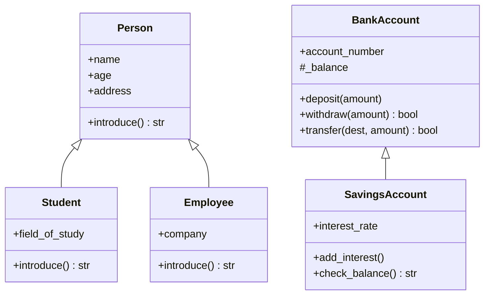

# 03 · OOP: operator overloading, inheritance, abstraction

> Slide 67: https://gist.github.com/bdallard/b2f2c910e3a9b564a30c86991c97b4fc
> Slides 61-64: ABC & Protocol examples

| File | Content |
|---|---|
| [`operator_overloading.py`](operator_overloading.py) | `Complex` (+ −), `Person` (> on age), `Vector` (* = dot product), `Circle` (all 6 comparisons), `Point` (compared by distance to origin), `Matrix` (* = matrix product) |
| [`inheritance.py`](inheritance.py) | `Vehicle → Car / Bicycle`, `Person → Student / Employee`, `BankAccount → SavingsAccount` with `transfer()` |
| [`abstraction.py`](abstraction.py) | An ABC (`Shape`) vs a `Protocol` (`Drawable`), plus the MRO |
| [`tests/test_oop.py`](tests/test_oop.py) | 18 tests |

```bash
python operator_overloading.py
python inheritance.py
python abstraction.py
pytest 03-oop          # from the repo root
```

## What I learned

- Return **`NotImplemented`** (not `False`, not an exception) when the other operand has the wrong type. Python then tries the reflected operation and raises a clean `TypeError` if nothing works.
- If you define `__eq__`, Python sets `__hash__ = None`, so the object can't go in a `set` or be a `dict` key anymore. I added `__hash__` back.
- For `Circle` I wrote all six comparisons by hand to practise. For `Point` I used **`@functools.total_ordering`**: you write `__eq__` and `__lt__` and it generates the rest.
- Distances are floats, so `Point.__eq__` uses `math.isclose` instead of `==`.
- `super().introduce()` reuses the parent's sentence instead of copy-pasting it.
- `BankAccount._balance` is "protected" by convention, and the read-only `balance` property exposes it (encapsulation).


