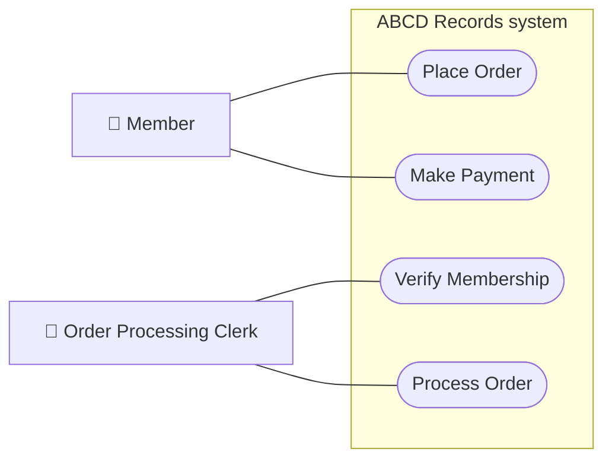
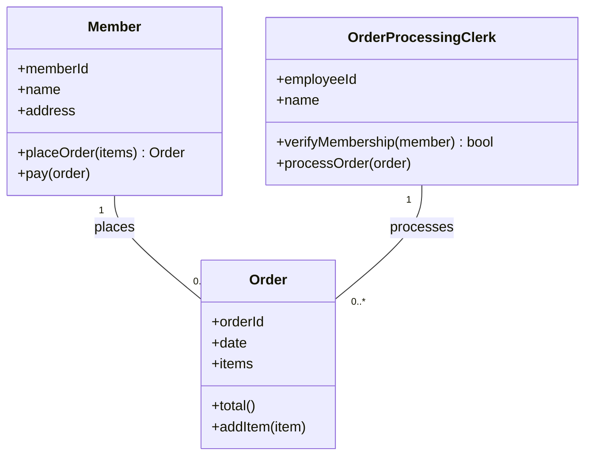
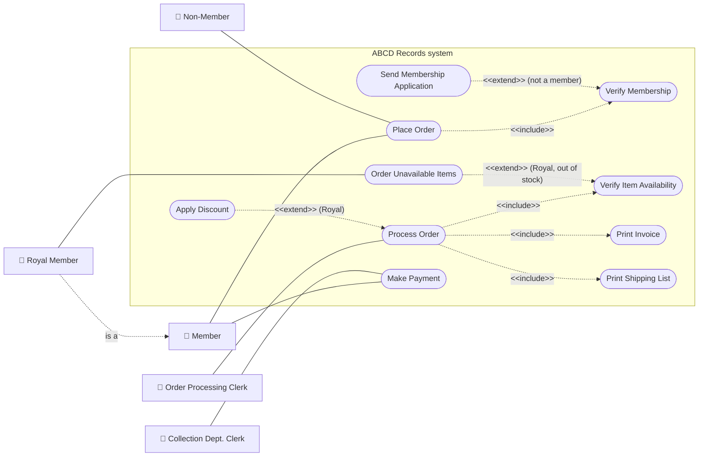
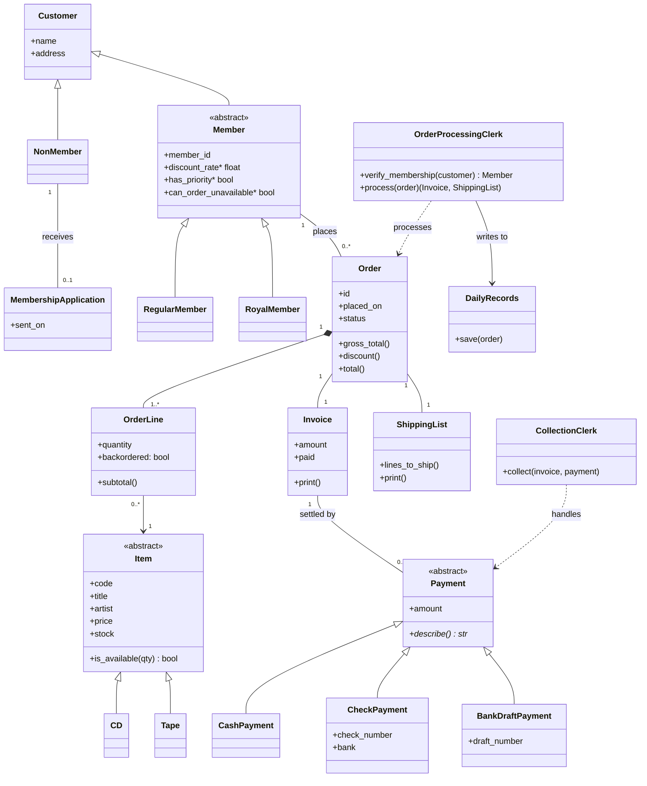
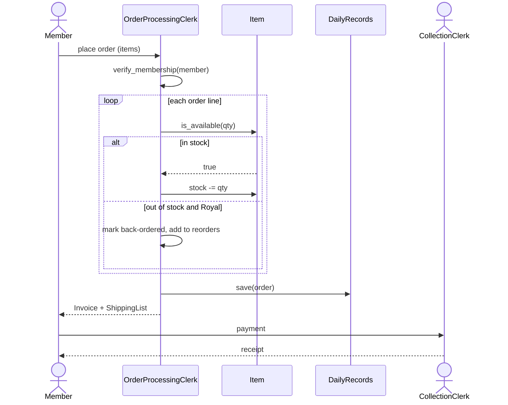
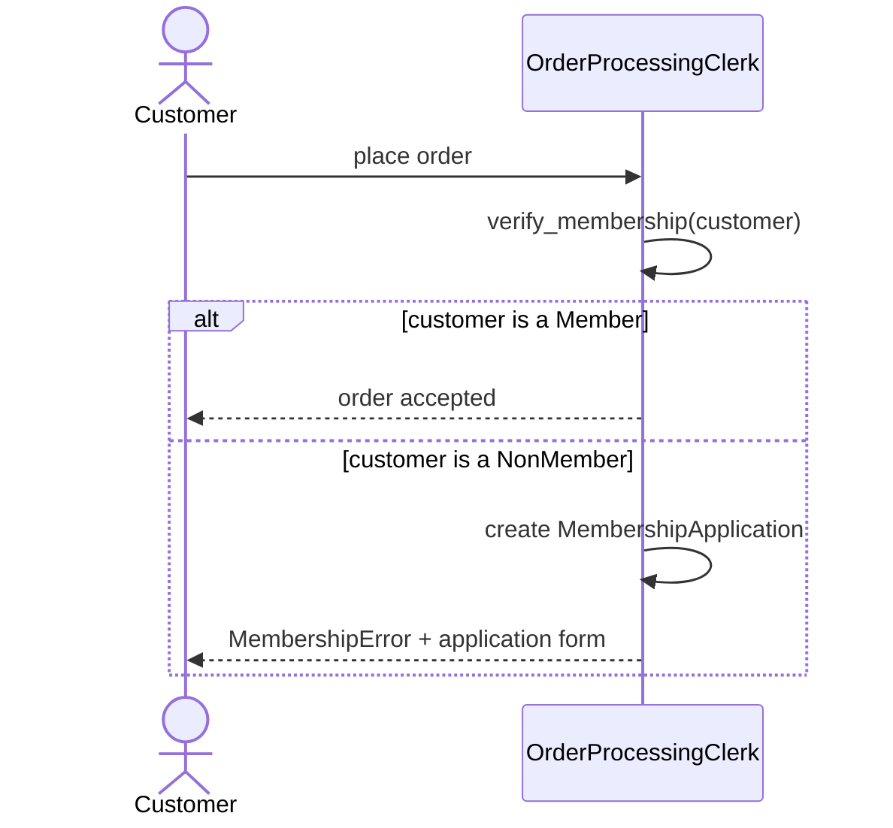
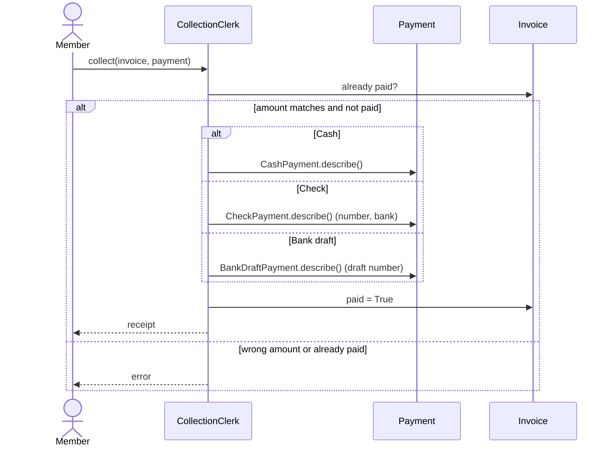
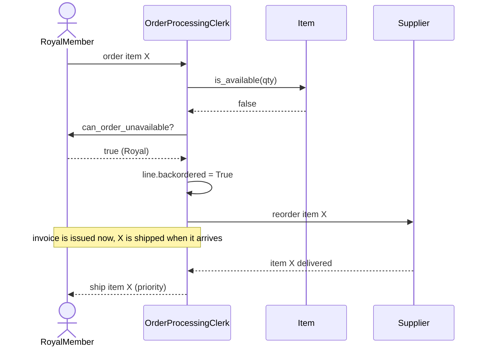

# Exo 2 · ABCD Records 📼

> https://gist.github.com/bdallard/2d2407c4de4c182afca6d3ec7235e9eb

Mermaid has no real use-case diagram, so I draw them as flowcharts:
- 🧍 nodes = **actors**
- rounded nodes = **use cases**
- the box = **system boundary**
- dotted arrows = `<<include>>` / `<<extend>>`

The final model is implemented in [`abcd_records.py`](abcd_records.py) and tested in [`../tests/test_abcd_records.py`](../tests/test_abcd_records.py).

## Level 1

### 1.1 Use case diagram



### 1.2 Class diagram



## Level 2

### 2.1 Complete use case diagram



- **include** = always happens. Placing an order *always* verifies membership, and processing *always* checks availability and prints the invoice and shipping list.
- **extend** = only sometimes. The application form is sent *only* to non-members, the discount *only* applies to Royal members, and unavailable items are ordered *only* for Royal members.

### 2.2 Complete class diagram



**Scenario: a Royal member orders 2 CDs (one unavailable) and pays by check.** This is the `__main__` of `abcd_records.py`:

```
INVOICE ORD-0001 - Mathis
  1 x Kind of Blue             15.00
  1 x Abbey Road               18.00 (back-ordered)
  Royal discount            -  3.30
  TOTAL                       29.70

SHIP TO Mathis, 1 rue de Paris, 75001 Paris [PRIORITY]
  1 x CD CD-001 'Kind of Blue'

Back-orders: ['Abbey Road']
Received 29.70€ check n°0012345 (BNP) for ORD-0001
```

## Level 3: Sequence diagrams

### 1. Complete order processing flow



### 2. Membership verification (success and failure)



### 3. Payment processing (all types)



### 4. Item reordering for Royal members


