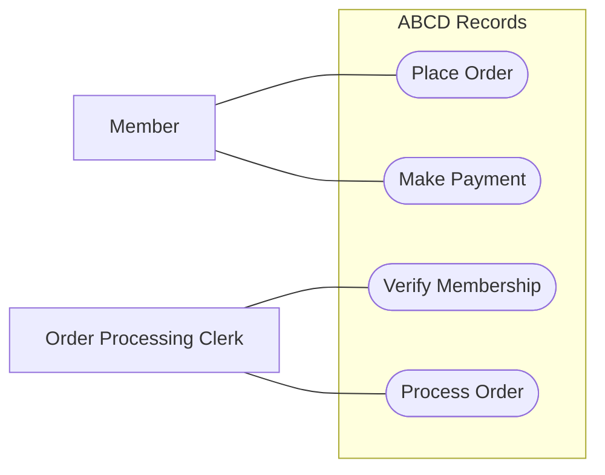
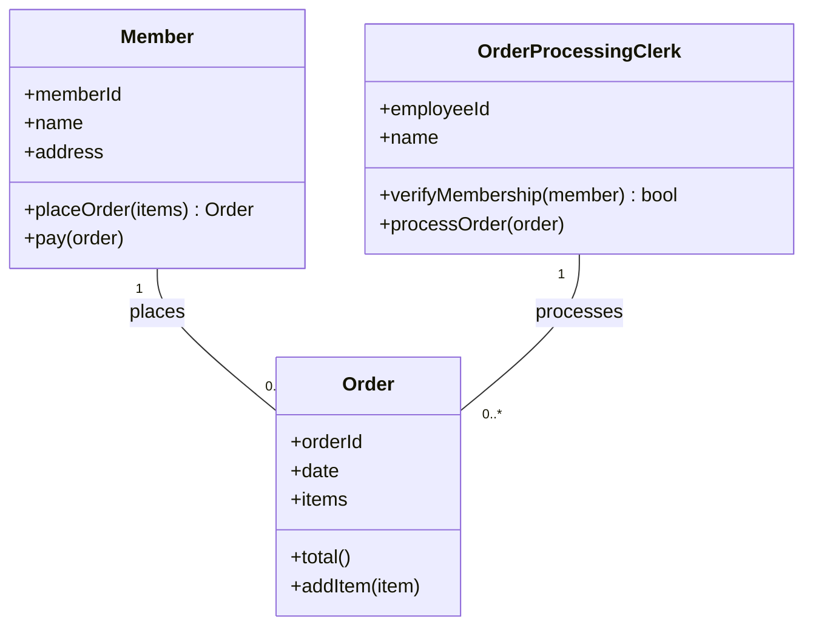
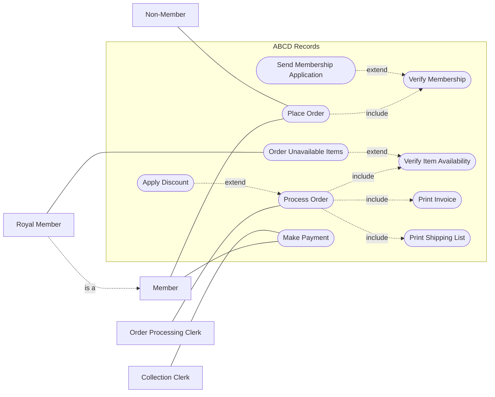
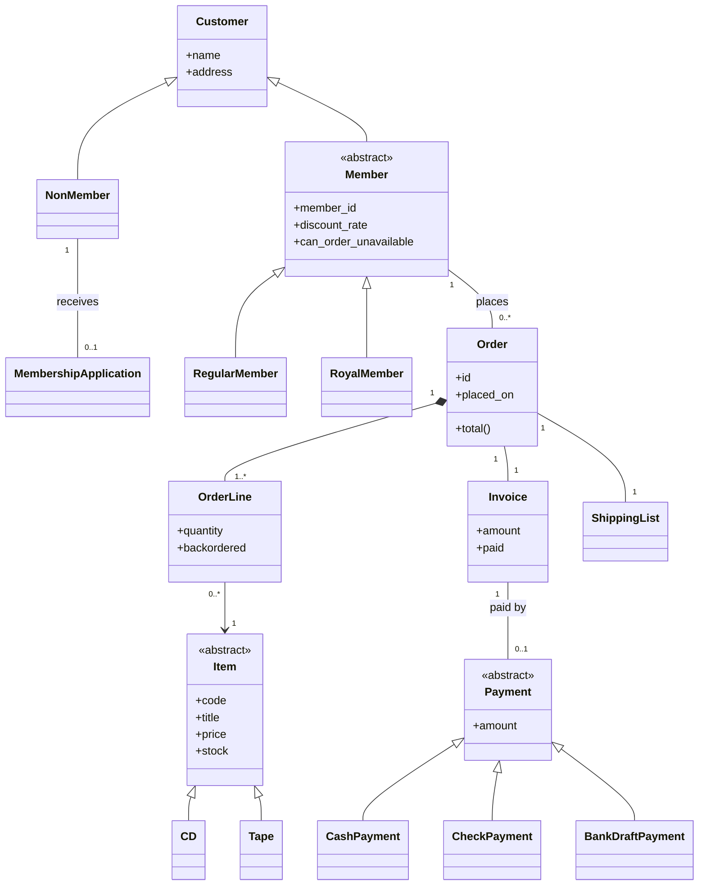
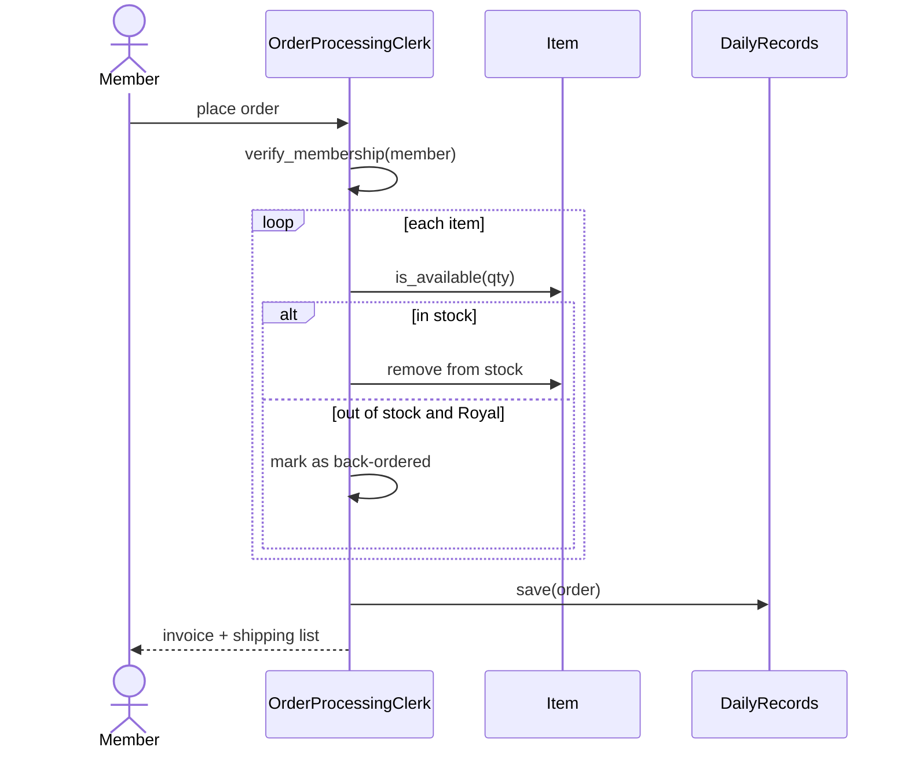
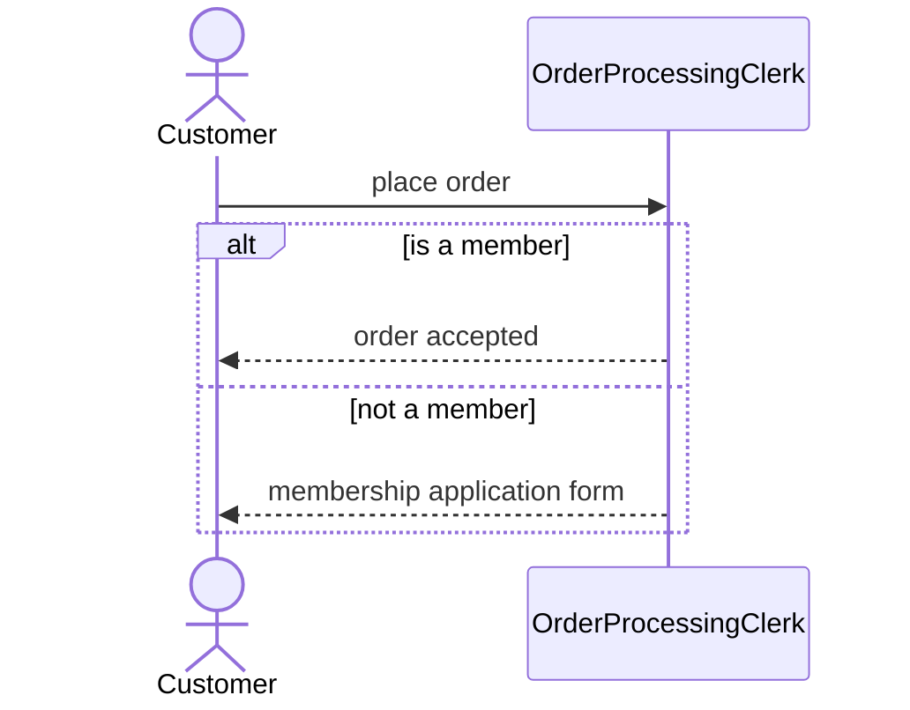
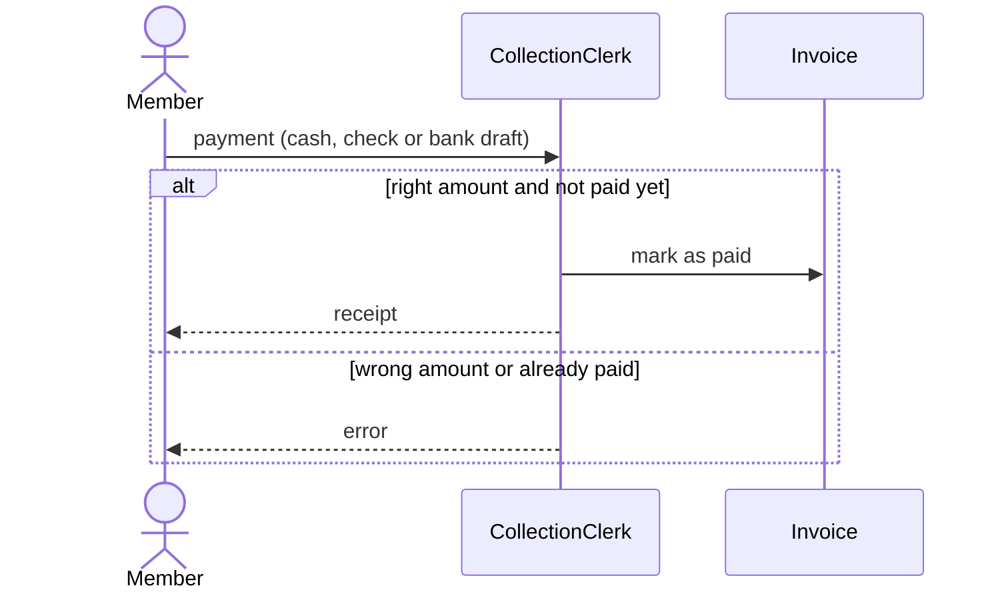
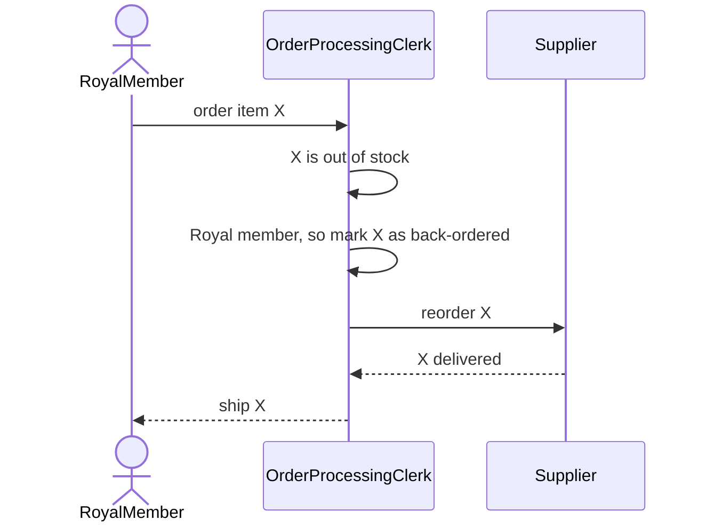

# Exo 2 - ABCD Records

The final model is coded in `abcd_records.py`.

Mermaid has no use case diagram, so I drew them as flowcharts (the box is the system, dotted arrows are include/extend).

## Level 1

### Use case diagram



### Class diagram



## Level 2

### Use case diagram



Include = always happens (placing an order always checks membership). Extend = only in some cases (the application form is only sent to non-members, the discount is only for Royal members).

### Class diagram



Scenario: a Royal member orders 2 CDs, one is out of stock, and pays by check. Output of `python abcd_records.py`:

```
INVOICE ORD-0001 - Mathis
  1 x Kind of Blue             15.00
  1 x Abbey Road               18.00 (back-ordered)
  Royal discount            -  3.30
  TOTAL                       29.70

SHIP TO Mathis, 1 rue de Paris, 75001 Paris [PRIORITY]
  1 x CD CD-001 'Kind of Blue'

Back-orders: ['Abbey Road']
Received 29.70€ check n°0012345 (BNP) for ORD-0001
```

## Level 3 - Sequence diagrams

### Order processing



### Membership verification



### Payment



### Reordering for Royal members


