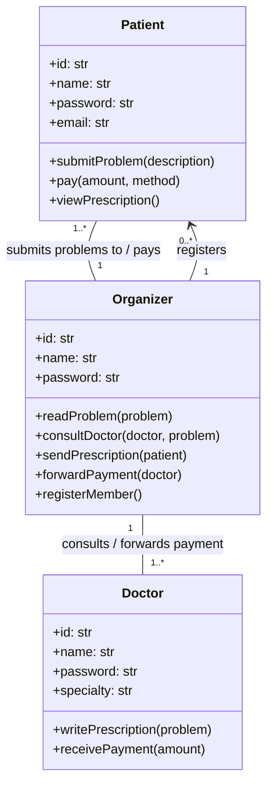
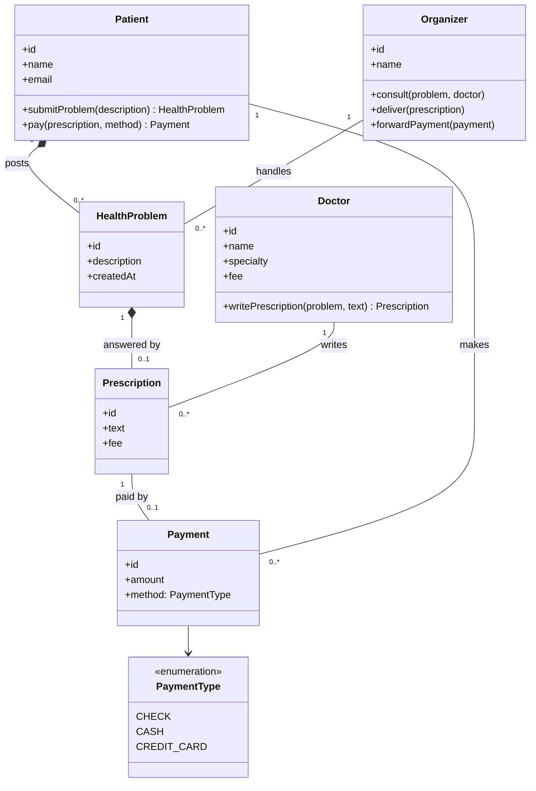
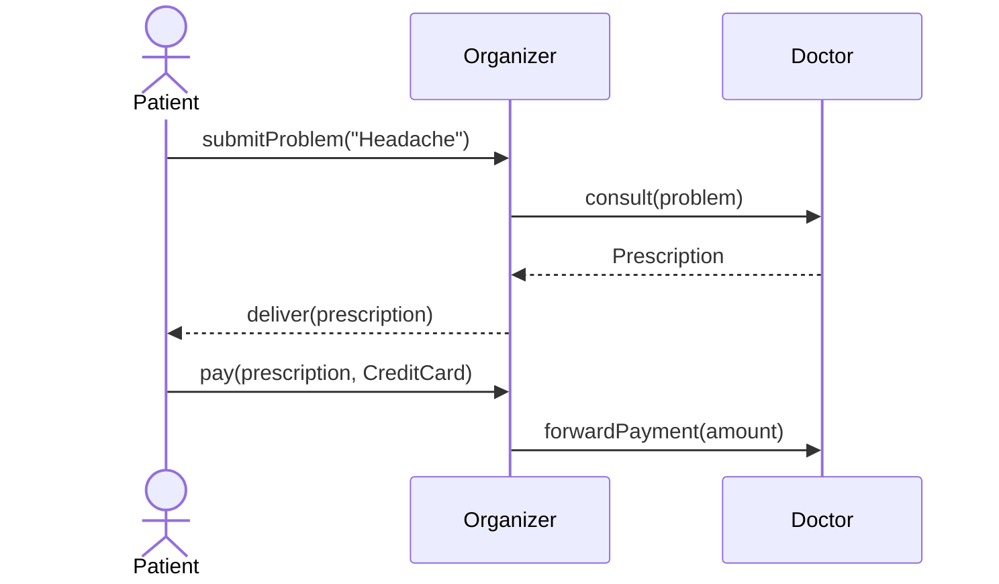
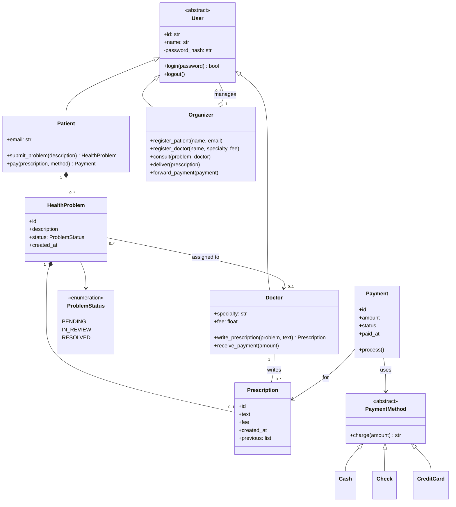
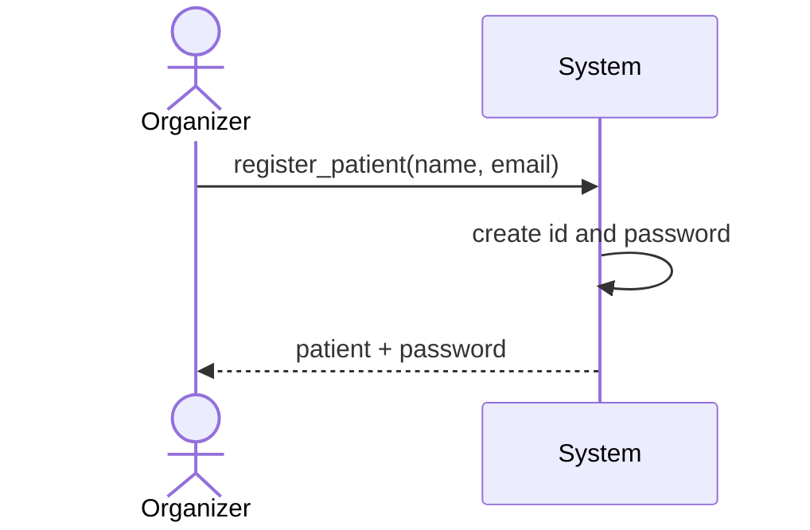
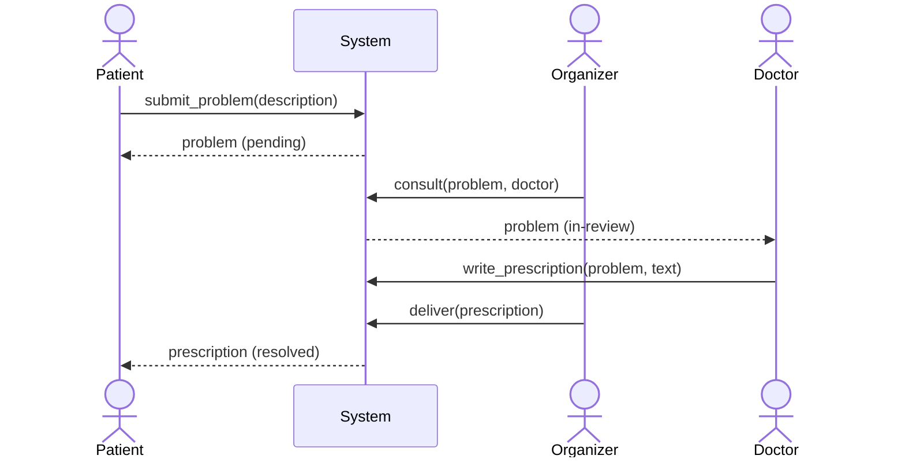
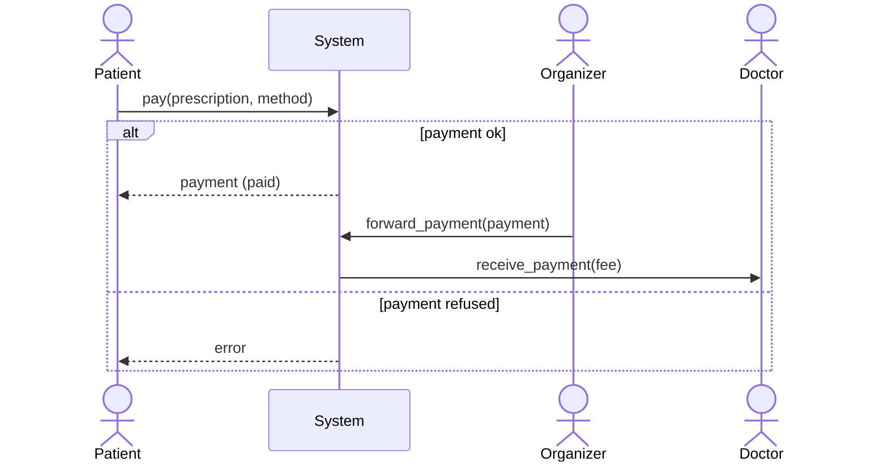

# Exo 1 - Hospital Management System

The final model (task 3) is coded in `hospital.py`.

## Task 1 - Class diagram

The patient never talks to the doctor directly, everything goes through the organizer.

## Task 2 - Class diagram with the 6 classes

I used composition because a health problem belongs to one patient and a prescription only exists for one problem.

Sequence diagram: a patient submits a problem, gets a prescription and pays.

## Task 3 - Advanced

Changes:
- a `User` superclass with id, name, password, login and logout
- payment types are classes that inherit from `PaymentMethod`
- `HealthProblem` has a status: pending, in-review, resolved
- timestamps, and each prescription keeps the patient's previous prescriptions

### Patient registration

### Consultation

### Payment

## Questions

1. Multiple doctors: each problem has its own doctor, so a patient can see a different doctor for each problem.
2. Reusable prescriptions: I don't reuse the same object. For a renewal I create a new prescription that points to the old one, so the history is kept.
3. Design pattern for payments: Strategy. Each payment type is a class with its own `charge()`, so adding a new one doesn't change the rest.
4. Data integrity: a payment can only go created -> paid -> forwarded, it can't be paid or forwarded twice, and the amount comes from the prescription, not from the patient.
