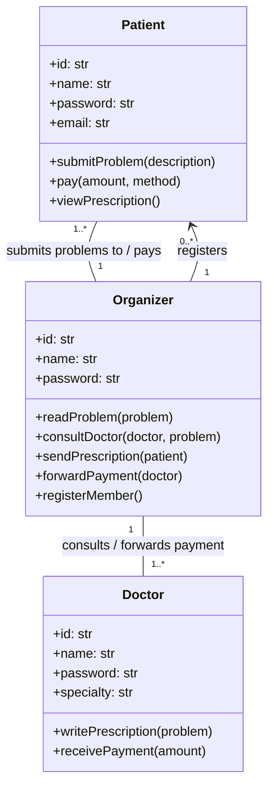
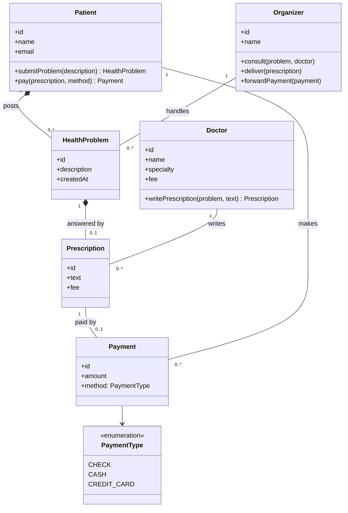
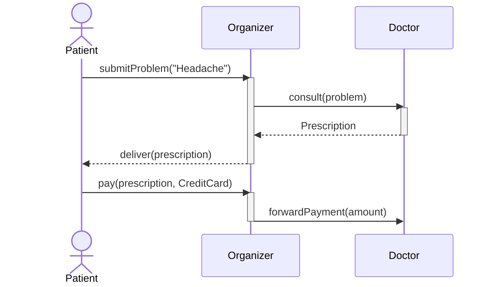
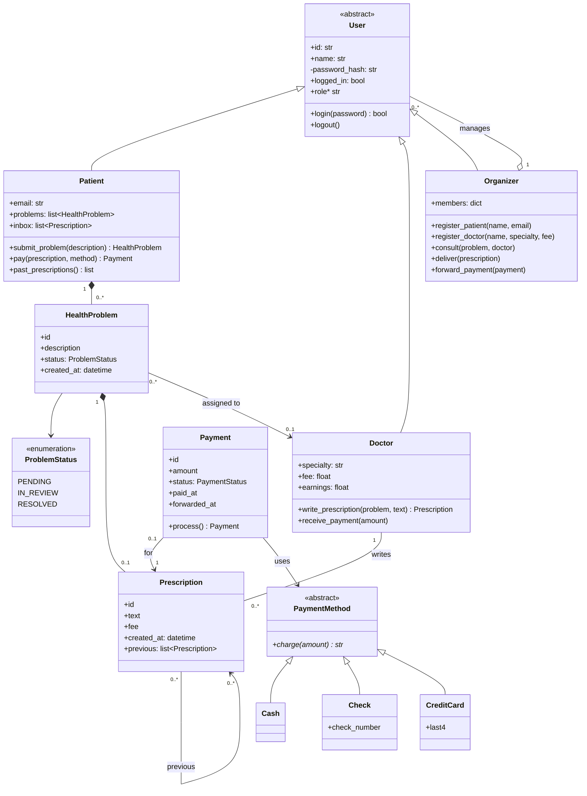
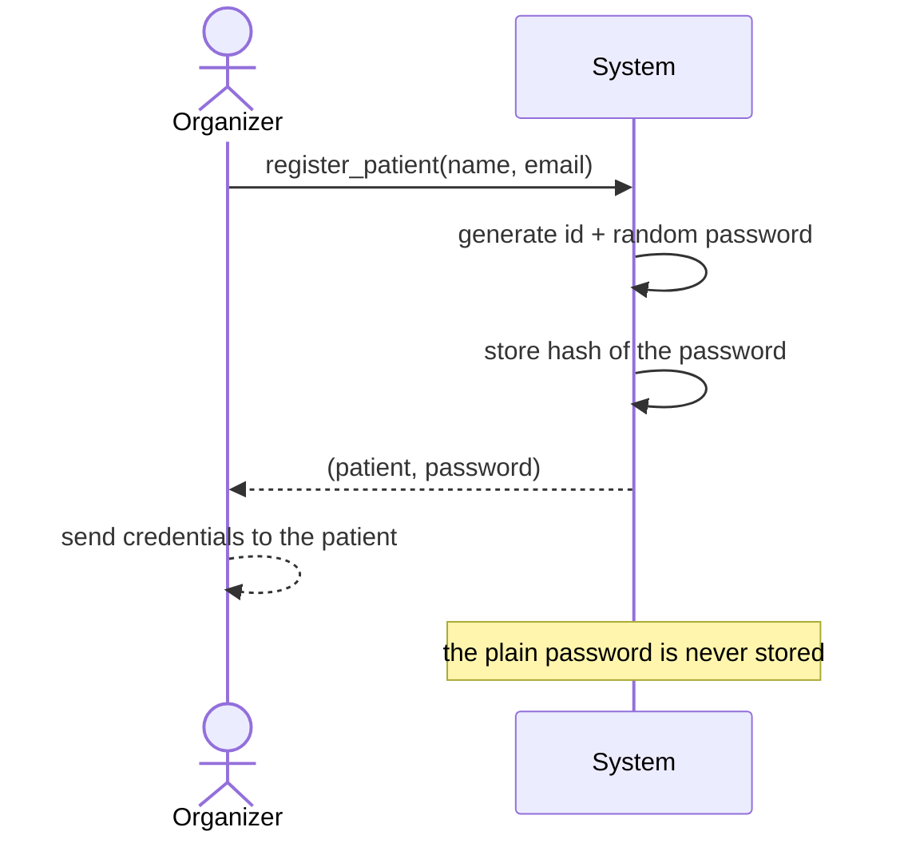
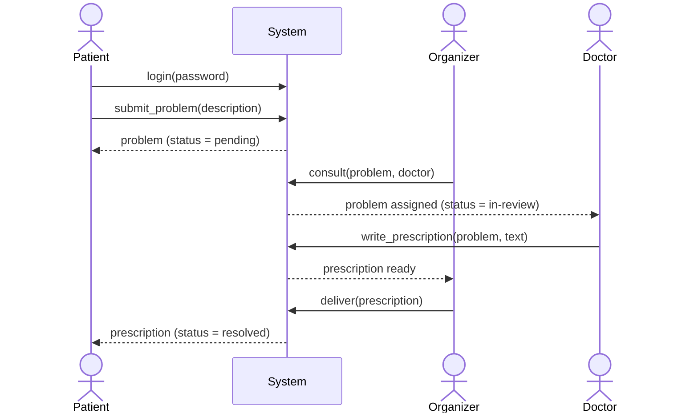
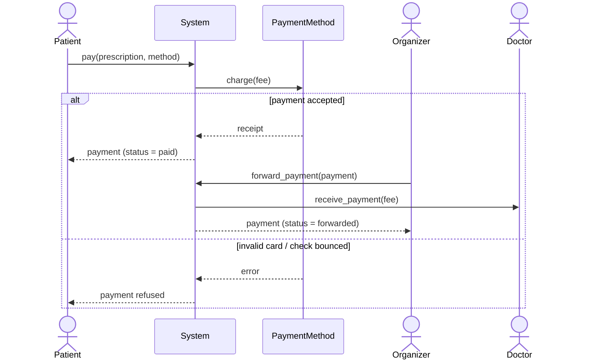

# Exo 1 · Hospital Management System 🏥

> https://gist.github.com/bdallard/2d2407c4de4c182afca6d3ec7235e9eb

All diagrams are written in [Mermaid](https://mermaid.js.org/), so GitHub renders them directly. The final model (Task 3) is implemented in [`hospital.py`](hospital.py) and tested in [`../tests/test_hospital.py`](../tests/test_hospital.py).

## Task 1: Basic class diagram

*Who talks to whom?* The patient never talks to the doctor directly: the **Organizer** sits in the middle of every exchange.

## Task 2: Full class diagram (6 classes)

- **Composition** (filled diamond): a `HealthProblem` only exists inside a patient's file, and a `Prescription` only exists as the answer to a problem.
- At this step the payment type is an **enumeration**. In Task 3 it becomes a class hierarchy (polymorphism).

### Sequence: a patient submits a problem, gets a prescription and pays

## Task 3: Advanced model

Changes from Task 2:
- a `User` superclass holds `id`, `name`, `password` and `login/logout`
- `PaymentMethod` is an abstract class, and each payment type implements `charge()` its own way (Strategy pattern)
- `ProblemStatus`: pending → in-review → resolved
- timestamps everywhere, and every prescription keeps a reference to the patient's previous prescriptions

### SSD 1: Patient registration

### SSD 2: Consultation flow

### SSD 3: Payment processing

## Questions to consider

1. **A patient consulting several doctors?** Each `HealthProblem` gets its own assigned `Doctor`, so a patient with 3 problems can see 3 different doctors. To get a second opinion on *one* problem, I'd turn `HealthProblem → Doctor` into a list of `Consultation(doctor, problem, opinion)` objects (an association class).
2. **Should prescriptions be reusable?** Not by copying the same object: a prescription is a medical record linked to a date, a doctor and a problem. For a renewal, I'd create a **new** `Prescription` that points to the old one (`previous`). The history is kept and nothing gets overwritten.
3. **Design pattern for payments?** The **Strategy** pattern: `PaymentMethod` is the interface, and `Cash`/`Check`/`CreditCard` are interchangeable strategies, so a new type (PayPal…) means a new class and no change to `Payment`. A **Factory** could build the right method from a string sent by the web form.
4. **Data integrity for payments?** `Payment` is a small state machine (`created → paid → forwarded`) that refuses double processing and double forwarding. The amount comes from the prescription's fee, never from the patient. Only the last 4 digits of the card are stored. In a real system the "pay + update status" step would run in a single database transaction.
