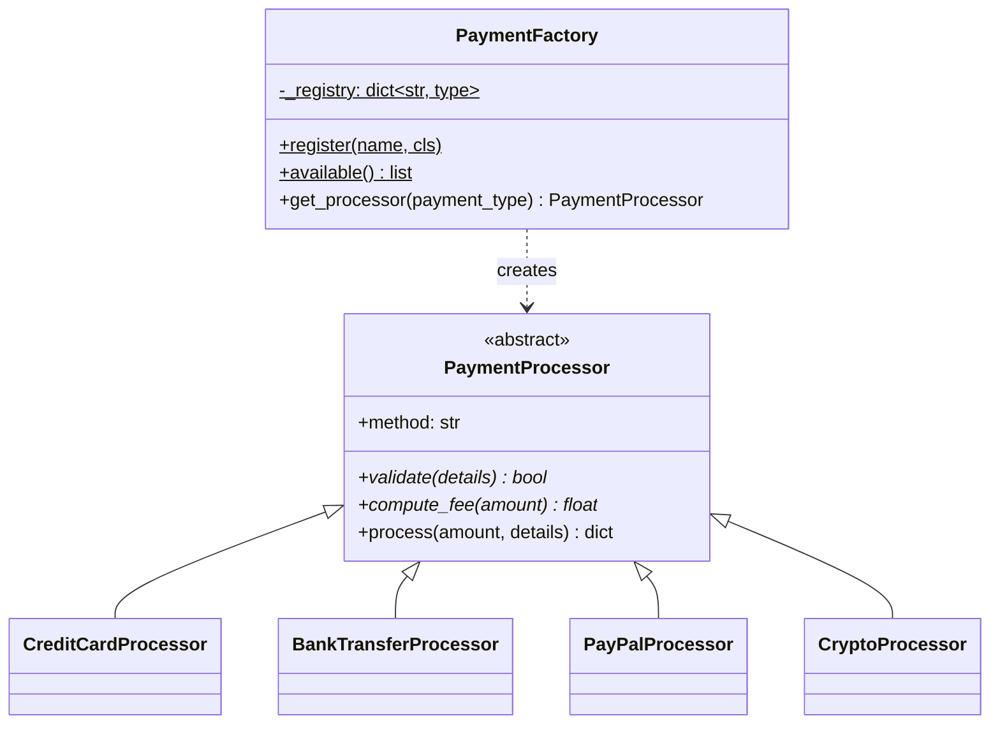
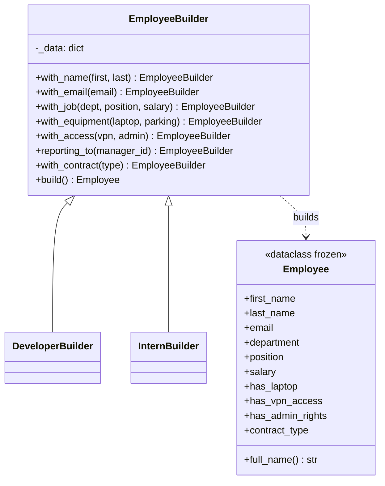
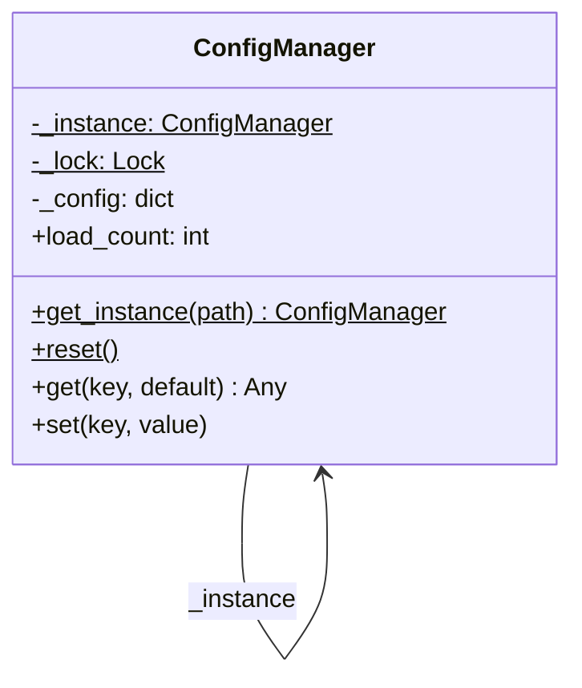
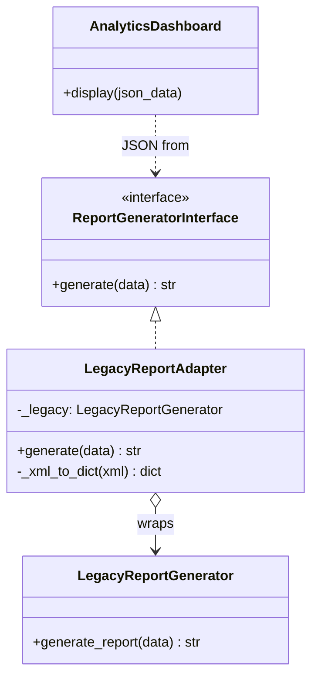
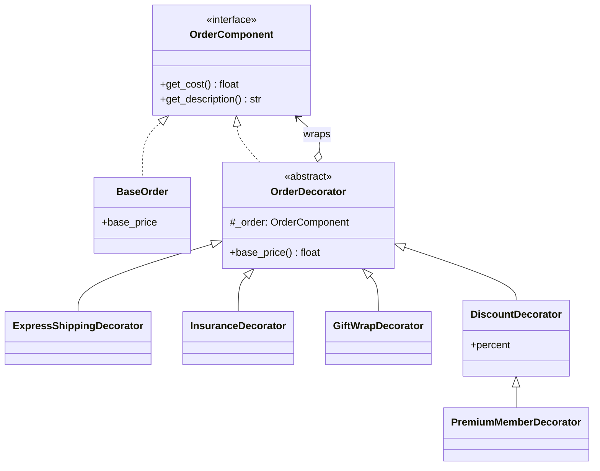
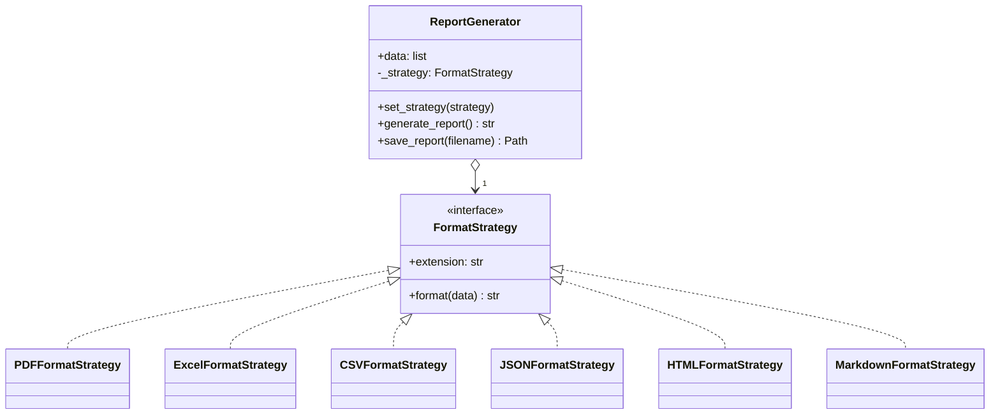
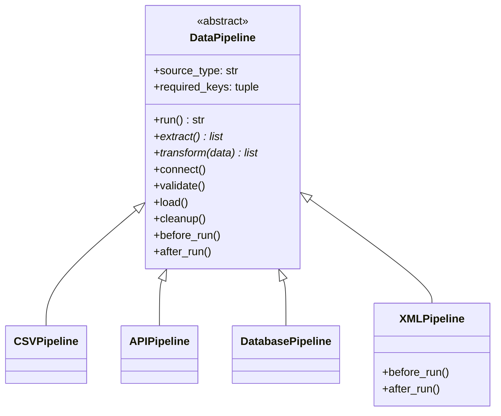

# 05 · Design patterns

> Slides 70-87. Exercises: [creational](https://courses.dallard.tech/sys_design/creational_pattern/) · [structural](https://courses.dallard.tech/sys_design/structural_pattern/) · [behavioral](https://courses.dallard.tech/sys_design/behavioral_pattern/)

For every exercise, as the course asks, I:
1. listed the problems of the spaghetti code (in the docstring at the top of each file),
2. drew the UML class diagram **before** coding (below),
3. refactored, and checked the "expected usage" from the course works (`__main__` of each file),
4. proved it's extensible by adding a new variant without touching the existing classes.

| Type | Pattern | Exercise | File | Extension added |
|---|---|---|---|---|
| Creational | Factory | Payment system | [`creational/factory_payment.py`](creational/factory_payment.py) | `CryptoProcessor` via `register()` |
| Creational | Builder | HR employee onboarding | [`creational/builder_employee.py`](creational/builder_employee.py) | `DeveloperBuilder`, `InternBuilder` presets |
| Creational | Singleton | Config manager | [`creational/singleton_config.py`](creational/singleton_config.py) | thread-safe + `set()` shared by all modules |
| Structural | Adapter | XML → JSON reports | [`structural/adapter_report.py`](structural/adapter_report.py) | real XML parsing (no "cheating" with the original dict) |
| Structural | Decorator | Order pricing | [`structural/decorator_order.py`](structural/decorator_order.py) | `PremiumMemberDecorator` *is a* `DiscountDecorator` |
| Behavioral | Strategy | Report formats | [`behavioral/strategy_report.py`](behavioral/strategy_report.py) | `HTMLFormatStrategy`, `MarkdownFormatStrategy` |
| Behavioral | Template Method | ETL pipelines | [`behavioral/template_etl.py`](behavioral/template_etl.py) | `XMLPipeline` + hooks |

```bash
python 05-design-patterns/creational/factory_payment.py   # any file runs on its own
pytest 05-design-patterns                                 # 39 tests
```

---

## Factory: payment system

`if/elif` on `payment_type` → one class per provider + a registry dict. The shared `process()` (validate → fee → result) is written once in the base class.



## Builder: employee onboarding

17 positional parameters → chainable `with_*()` methods that return `self`. All the validation happens in `build()`, which returns a **frozen** dataclass. Presets encode business rules (a developer always gets admin + VPN).



## Singleton: config manager

`load_config()` read the file 4 times → `ConfigManager.get_instance()` reads it once (the demo prints `File read 1 time(s) for 4 modules`). I added a lock for threads, `reset()` for tests, and `get("a.b.c")` for nested keys.



## Adapter: legacy XML → JSON dashboard

The original code didn't really convert anything: it called `json.dumps` on the dict it already had. My adapter parses the XML coming out of the legacy library (with `xml.etree`) and restores the number types.



## Decorator: order pricing

5 boolean flags → stackable wrappers. The order you wrap them in is the order of the calculation (a test shows that discount-then-shipping ≠ shipping-then-discount). Same total as the original code: **95.625 €**.



## Strategy: report formats

Two parallel `if/elif` chains → one class per format. Each class knows its text **and** its file extension, so `save_report()` has no `if` left. HTML and Markdown were added without editing anything else.



## Template Method: ETL pipelines

3 copy-pasted `run()` methods → one `run()` in the base class. Subclasses only write `extract()` + `transform()` + `required_keys`. `cleanup()` is in a `finally`, so it runs even when validation fails. `XMLPipeline` uses the `before_run`/`after_run` hooks to time itself.



## When to use which (slide 86)

| Smell in the code | Pattern |
|---|---|
| lots of `if/elif` on a type | Strategy / Factory |
| function with 10+ parameters | Builder |
| same config loaded everywhere | Singleton |
| two systems that don't speak the same format | Adapter |
| options stacked with boolean flags | Decorator |
| copy-pasted classes with the same steps | Template Method |
