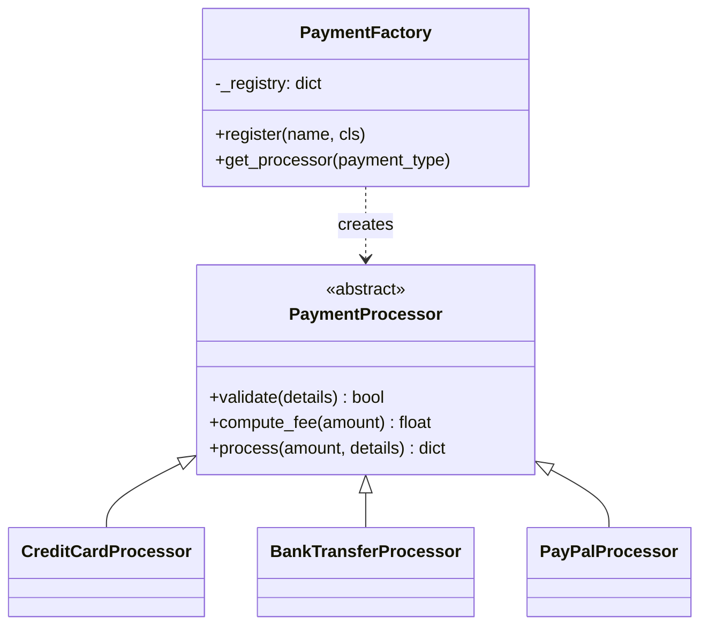
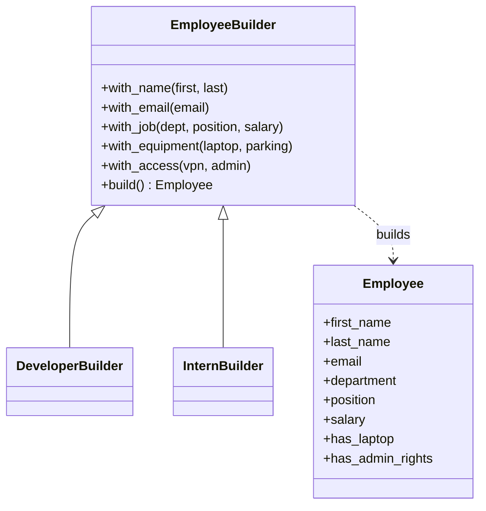
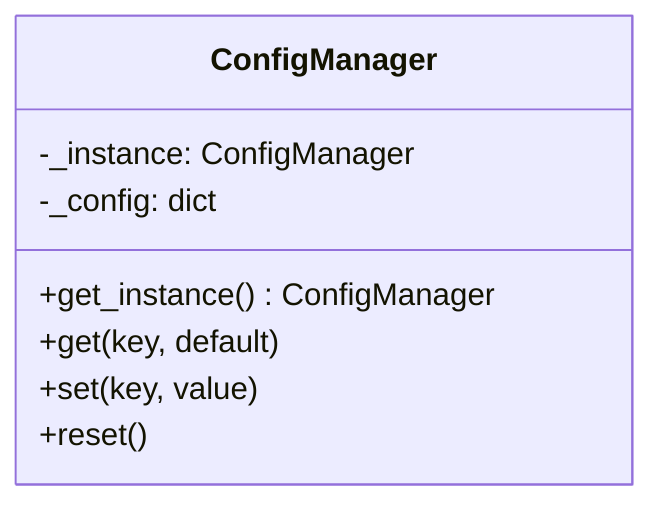
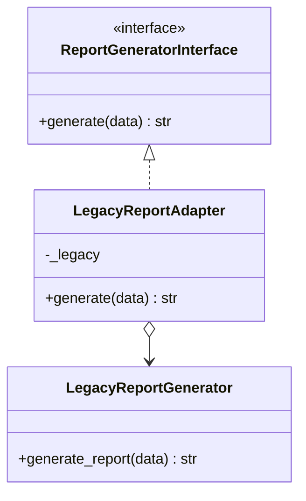
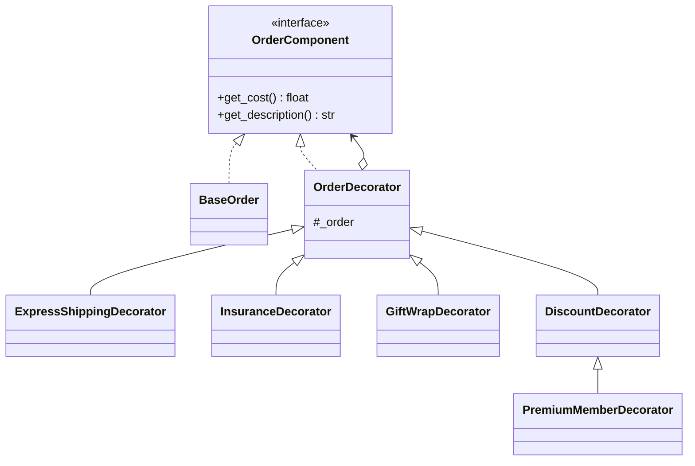
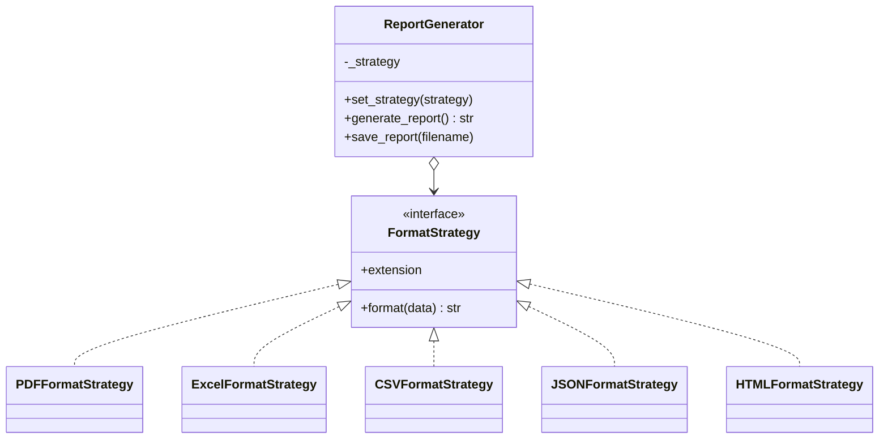
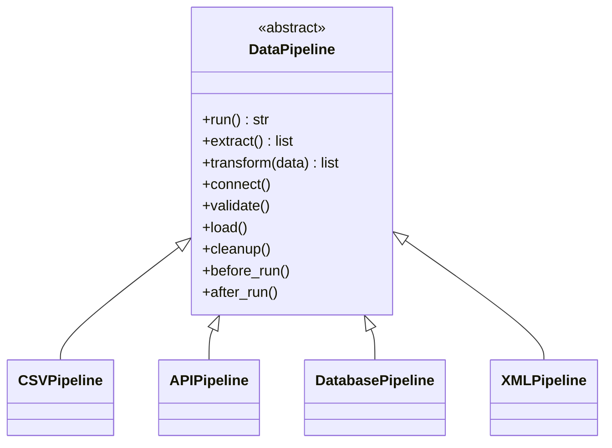

# 05 - Design patterns

Each file starts with the problems of the original code, then the refactored version. Running a file shows the expected usage.

- `creational/factory_payment.py`: Factory (payment system)
- `creational/builder_employee.py`: Builder (employee onboarding)
- `creational/singleton_config.py`: Singleton (config manager)
- `structural/adapter_report.py`: Adapter (XML report to JSON)
- `structural/decorator_order.py`: Decorator (order pricing)
- `behavioral/strategy_report.py`: Strategy (report formats)
- `behavioral/template_etl.py`: Template Method (ETL pipelines)

```bash
python creational/factory_payment.py
```

## Factory

The big if/elif is replaced by one class per payment method and a factory that uses a dict to find the right class. I added a crypto payment with `register()` without changing the other classes.



## Builder

The function with 17 parameters is replaced by methods you can chain. Validation is done in `build()`. `DeveloperBuilder` and `InternBuilder` are presets.



## Singleton

The config file used to be read 4 times. Now `ConfigManager.get_instance()` reads it once and always returns the same object. `get("database.host")` reads nested values.



## Adapter

The old generator returns XML and can't be changed. `LegacyReportAdapter` wraps it and converts the XML to JSON for the dashboard.



## Decorator

The 5 boolean flags are replaced by decorators that wrap the order. The order of the wrapping is the order of the calculation.



## Strategy

One class per format instead of the if/elif chains. The format can be changed with `set_strategy()`. I added HTML without changing the other classes.



## Template Method

`run()` is written once in the base class and calls the steps in order. Each pipeline only writes `extract()` and `transform()`. I added `XMLPipeline` to check it works.


